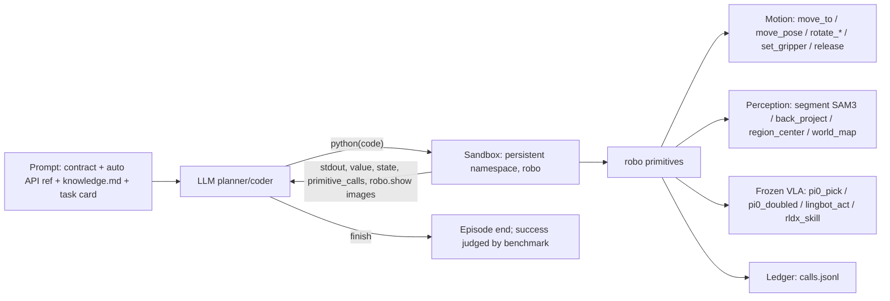

# PyRUA-Lean (DAGroup-PKU): Python-cell robot agent

Reference notes on an external embodied agent that is close to this repo: a frontier LLM writes Python
against a robot object, composing analytic primitives, SAM3 perception and (optionally) frozen VLA skills.
These notes describe *their* system. Ideas we could adopt are in `docs/plans/other_agents_ideas.md`.

- Project docs: https://dagroup-pku.github.io/PyRUA-Lean/docs/
- Paper: *Fewer Tokens, Better Action: GPT-6 Astra Robot Agents with 14% Higher Success Rate but 65% Fewer
  Tokens*, arXiv:2610.01939 (v2, 13 Oct 2026), https://arxiv.org/html/2610.01939v2
- Code: https://github.com/DAGroup-PKU/PyRUA-Lean (notes based on commit `ffad6d4`)
- Model: https://huggingface.co/DAGroup-PKU/PyRUA-Lean-Coder-v0.1-4B

## 1. TL;DR

- **PyRUA** = "**Py**thon for Lean **R**obot-**U**se **A**gents", the robot counterpart of computer-use agents.
- **Interface.** The agent has one tool, `python(code)`, plus `finish`. The code runs in a **persistent
  namespace** that holds `robo`. One LLM call (a "cell") can run many primitives, check what they return,
  retry, and pick what feedback to send back to the LLM. The usual alternative is tool calling: one LLM call
  per primitive, with the whole history re-sent every time.
- **Planner.** GPT-6 Astra (Codex CLI, high reasoning effort). The planner writes the code itself; there is
  no separate coder model.
- **Execution.** Primitives are analytic motion and gripper skills, SAM3 segmentation, pixel back-projection,
  and optional frozen VLAs as ordinary methods: π0.5 on LIBERO-PRO, LingBot-VLA on RoboTwin, RLDX-1 on
  RoboCasa. RoboDojo runs with no VLA.
- **Results.** On 700 paired instances, success goes from 63.1% to 71.7% compared with tool calling. On
  jointly solved instances it uses 49% fewer LLM calls and 65% fewer input tokens. On RoboDojo-Sim it ranks
  first with a 51.6% success rate (SR), against 32.3% for the best leaderboard entry. It uses no VLA there.
- **Small model.** Qwen3.5-4B trained with GRPO on 45 LIBERO-PRO instances (binary success reward) goes from
  18.8% to 44.1% on 655 unseen instances, beating Qwen3.5-27B (29.2%).

## 2. Architecture

### 2.1 Prompt (what the model reads)

The prompt is built in `src/pyrualean/prompt.py` by `render_prompt()` and has four parts:

1. **Contract.** "You control … by WRITING A PROGRAM, not by chatting with the robot." It also explains how
   episodes are scored, the exception taxonomy, and the allowed imports.
2. **API reference.** Generated from the live robot class with `inspect.signature`/`getdoc`, "so the model
   always sees exactly the functions the host will inject". It cannot drift from the code.
3. **Operating knowledge.** A hand-written file per robot (`knowledge/<robot>.md`, with `-novla` variants)
   covering frames, units, primitive behaviour and pitfalls. It is the same for every task: "no task
   recipes".
4. **Task card.** The instruction, movable object **names** (no poses), the starting gripper state, the step
   budget and the step-0 images. "Nothing privileged such as object poses is included."

### 2.2 Execution model

- **Two arms.** In `cells` (the default), each LLM call is one cell in a persistent notebook namespace. In
  `program`, each LLM call is a whole `def run(robo)` program in a fresh namespace.
- **Results, not exceptions.** A motion blocks until done and returns what actually happened
  (`Move.reached`, `Pick.success`, `Segment.found/score`). Only misuse raises `ValueError`/`ToolError`.
  `EpisodeFinished` derives from `BaseException`, so `except Exception` cannot swallow the end of an episode.
- **Failure inside a cell.** An uncaught exception ends the cell and returns the traceback. Variables
  assigned before it stay in the namespace, so the next cell can repair and continue.
- **Feedback from a cell** (`arms.py`). It returns stdout/stderr (trimmed to 8k chars, keeping the head and
  tail), the value of a trailing expression, and the exception. In `rich` mode it also returns the last 40
  primitive-ledger records, `moved`, `env_steps` and robot state.
- **Image policy.** Images are attached `on-motion` (default), `on-demand` (only what `robo.show(cam)` asked
  for) or `none`. The cell can also call `display(img)` to attach any array, such as a crop or overlay.
- **Sandbox** (`sandbox.py`). Imports are limited to an allow-list (numpy, math, cv2, scipy, skimage, PIL…).
  `exec`, `eval` and `open` are removed or guarded, and file access is confined to the workspace.
  Introspection escapes (`__globals__`, `__subclasses__`) are blocked. `audit_source()` flags any attempt to
  reach host internals, and those flags are stored in `result.json` (`sandbox_flags`).
- **Budgets.** `--max-turns` caps cells (`finish` is free). `--budget-s` is a wall-clock watchdog that
  interrupts the active primitive. The benchmark also enforces its own simulator-step budget. Process-group
  SIGTERM then SIGKILL is the hard safety net.
- **Audit.** Each episode writes `result.json` (success, status, calls, env steps, token usage, compactions,
  sandbox flags, timings), `calls.jsonl` (every primitive with args, outcome, elapsed time and sim steps),
  `prompt.txt`, `workspace/cell_NNN.py`, `episode.mp4` and the runtime event log. `pyrualean summarize`
  aggregates SR, status breakdown, calls and tokens.
- **Memory.** Within an episode, the namespace is the memory. There is **no cross-episode memory** (Codex
  memories are explicitly disabled).

### 2.3 LIBERO-PRO robot API (`LiberoRobot`, `libero.py`)

| Group | Methods |
|---|---|
| Observation | `task`, `done` (sticky success), `state()` (eef pos/quat, gripper opening, object names, `eef_yaw/pitch`), `image(cam)`, `world_map(cam)` (per-pixel XYZ), `camera_meta(cam)`, `show(cam)`, `artifact(name)` |
| Perception | `segment(prompt \| point)` (SAM3, returns found/world_xyz/score/box/overlay), `back_project(row, col)`, `region_center(rows, cols, z_min, z_max)` (container cavity) |
| Motion | `move_to(xyz, gripper, tol, step_clip, max_steps, target_yaw)` (≤0.30 m per call), `move_pose(xyz, target_pitch, target_yaw)` (escapes singularities and handles recessed targets), `rotate_wrist`, `rotate_pitch`, `set_gripper(g, steps)`, `release()` |
| VLA | `pi0_pick(prompt)` runs a closed-loop π0.5 grasp and reports a heuristic success (descent + closure + lift). `pi0_doubled(prompt)` handles knobs, drawers, doors and pushes. Both are hidden under `--primitives no-vla`. |

Other robots: RoboTwin (dual arm, explicit EEF→TCP 0.12 m offset), RoboCasa365 (mobile base, `navigate_to`,
`HOLD` gripper mode) and RoboDojo (two ARX-X5 arms with **no grasp primitive**: a grasp is a few lines of
code using `locate`, `move_to(path="line")` and `set_gripper` with a width check).

On **RoboDojo**, `locate(text, camera)` runs SAM3 in one camera and finds the object in the other cameras.
It returns center, top_z, height, footprint, long axis and **grasp_yaw**, and "reports how many cameras
agreed: one camera cannot measure a height". "We added a primitive only when a program could not build its
function from the others."

### 2.4 Operating knowledge examples (`knowledge/libero.md`, `robodojo.md`)

- "Every motion call holds its `gripper` value for the whole motion: carry with `gripper=+1` in every
  `move_to`; a carry with `-1` silently drops it."
- "Judge the grasp yourself: `Pick.success` is a hint, not proof. Read `state().gripper_opening` … and, if in
  doubt, `segment` the object in the wrist image."
- The VLA prompt ladder goes generic, then the task instruction, then a spatial qualifier, then reposition
  and retry.
- `step_clip` is 0.025 for an empty gripper, 0.015 for cans and 0.012 for bottles or fine approach.
- "There is no reset. Recover in place: re-localise, re-pre-position, re-issue the pick."
- RoboDojo has no success flag: "Judge progress from the images and the robot state, and say so when you
  cannot tell."
  - Grasp counts only when the target moves with the arm.
  - Placement counts only after the gripper opens and the arm withdraws.
  - Before `finish`, re-`locate` every named object.
  - Keep about 20 actions in reserve to home both arms.
  - Don't repeat the same failed recovery twice.

## 3. Training: PyRUA-Lean Coder v0.1-4B

| Item | Value |
|---|---|
| Base | Qwen3.5-4B (VLM, reasons before answering); full fine-tune, no SFT, no demonstrations |
| Data | 45 LIBERO-PRO instances (3 tasks × goal/spatial/object suites × 5 seeds) |
| Reward | 1 if the benchmark success check passes, else 0 (no shaping, no call/step penalty) |
| Algorithm | GRPO: 16 instances × 8 rollouts = 128 episodes/iter, group-normalized advantage, clip 0.2/0.28, Adam LR 1e-6, no KL, no entropy, 2 optimizer steps per iteration |
| Scale | 30 iterations = 3,840 episodes, 60 steps; ~12 h on one 8-GPU node (miles RL + SGLang; sim, VLA and SAM3 co-located) |
| Episode limits | Train: 24 cells / 25 min / 4,096 tokens per call. Eval: 40 cells / 90 min / 8,192 tokens per call, 65k context |

Training rollout SR rose from 0.30 to 0.70. **What it learned is mostly interface discipline.** It writes
one cell per call and reads the result before the next (the base model batched about 9 cells blind). Image
requests dropped from 19.3 to 0.8 per episode. Context overflow fell from 19.2% to 3.4% and cell-budget
endings from 52.7% to 10.5%. "We do not claim that training improved manipulation skill as such."

The GRPO trainer is **not** in the public repo; only the inference framework and weights are released.

## 4. Results

### 4.1 Tool calling vs. PyRUA-Lean (same GPT-6 Astra, primitives and VLAs)

| Benchmark | SR tool | SR code | Calls tool→code | Input tokens tool→code |
|---|---|---|---|---|
| LIBERO-PRO (40 tasks × 5 seeds) | 83.0 | **94.0** | 21.4 → 8.4 | 1.23M → 273k |
| RoboTwin 2.0 (50 × 5) | 60.0 | **69.2** | 12.2 → 8.9 | 415k → 245k |
| RoboCasa365 atomic | 78.9 | **86.7** | 10.4 → 5.6 | 261k → 171k |
| RoboCasa365 composite | 34.4 | **39.4** | 28.4 → 14.9 | 1.22M → 603k |
| **All (700)** | 63.1 | **71.7** | 17.0 → 8.7 | 788k → 276k ($1.63 → $0.74) |

- **Where the gain comes from.** 96 instances were solved only by code and 36 only by tool calling. Of the
  96, tool calling ran out of its call budget in 52.
- **Ablation: on-demand images.** Giving tool calling on-demand images *drops* it to 68.5% on LIBERO-PRO,
  so the gain comes from programmatic composition, not from the image policy.
- **Ablation: VLA and guides removed** (Table 3).
  - Without VLAs the code agent keeps most of its lead, and the gap grows: RoboTwin tool 42.8 vs code 68.8;
    RC365 atomic 45.6 vs 65.6; RC365 composite 7.5 vs 20.0.
  - Removing the knowledge guides costs code about 6 points on LIBERO-PRO (94.0 → 88.0) but can *help* tool
    calling: on RoboTwin without VLA it goes from 42.8 to 60.4.

### 4.2 RoboDojo-Sim (42 dual-arm tasks, 2,100 episodes, RGB only, no VLA, no success flag)

| Entry | Score / SR |
|---|---|
| **PyRUA-Lean** | **58.20 / 51.62** (first on all 5 dimensions) |
| VPP2 (best board entry, world-action model) | 39.26 / 32.26 |
| GPT-6 Astra direct EEF control | 28.97 / 22.48 |

- **Against direct control.** Precision goes from 4.0 to 37.3 and Long-Horizon from 8.3 to 48.0. The agent
  is better on 34 of 42 tasks.
- **Unsolved tasks.** `press_by_number`, `insert_key`, `make_kong` and `swap_blocks` stay at 0, which points
  to failures in contact without feedback and in tight fits.
- **Cost.** About 25.7 LLM calls, 750k input tokens, 12.7 min and $2.4 per episode.
- **Depth.** Adding depth helps only slightly (52.9 SR over 3 seeds, std 0.35).

### 4.3 Coder 4B (Table 8)

| Planner | Train (45) | Unseen (655) | RoboTwin | RC365 atomic |
|---|---|---|---|---|
| Qwen3.5-4B | 37.8 | 18.8 | 14.0 | 52.2 |
| Qwen3.5-27B | 64.4 | 29.2 | 20.8 | 65.6 |
| **Coder v0.1-4B** | **71.1** | **44.1** | **52.4** | **76.7** |
| GPT-6 Astra (reference) | 100 | 69.8 | 69.2 | 86.7 |

## 5. Inputs: Sim2Real view

- **Object poses are never given.** Positions come from `segment`/`locate`/`back_project` on recorded RGB
  and depth (or the world map). Proprioception covers the EEF, gripper and base.
- **Success flag.** On LIBERO, RoboTwin and RoboCasa the agent *can* read `robo.done`/`terminated` (the
  benchmark success flag). Under our Sim2Real rules that is **privileged**. RoboDojo withholds it, and
  PyRUA-Lean still ranks first there.
- **No physical-robot experiments.** The authors list real-robot performance as untested.

## 6. Comparison with this repo

| Aspect | PyRUA-Lean | This repo |
|---|---|---|
| Loop | Single LLM writes cells; no separate reviewer | Planner → subtask code-gen agent → VLM reviewer |
| Namespace | Persistent for the whole episode | Per attempt (`task_state.py` `exec_env`) |
| Feedback | Code chooses images (`robo.show`); structured results | Head and wrist images auto-attached every turn; failures raise |
| API docs | Generated from introspection | Hand-written in `prompts/main_prompt.py` |
| Knowledge | `knowledge/<robot>.md` (task-agnostic) | `prompts/skills/*/SKILL.md` via `load_skill` |
| Perception | SAM3 segment, multi-camera `locate`, `back_project`, `region_center` exposed to code | `detect_object` (head cam, point cloud), GraspGen poses, 3D tracking; back-projection is internal only |
| Motion | `move_to` (≤0.3 m), `move_pose`, `rotate_wrist`/`rotate_pitch`, `path="line"` | `[x, y, z, theta]` trajectories, preset pose builders |
| VLA | Optional frozen π0.5 / LingBot / RLDX-1 | None |
| Sandbox / audit | Allow-list sandbox, `calls.jsonl`, token/cost per episode | Plain `exec`; `motion_log`/`track.jsonl`; no token accounting |
| Benchmark | LIBERO-PRO, RoboTwin, RoboCasa365, RoboDojo; `summarize` | Bespoke FrankaKitchen/MetaWorld tasks; no batch harness |
| Training | GRPO on a 4B coder | None |

## 7. Limitations (as stated by the authors)

- The comparison covers one planner (GPT-6 Astra), one run per instance, simulation only. The effects of
  composition, persistent state and selective feedback are not fully isolated.
- **RoboDojo.** The authors did not measure how much of the margin comes from SAM3 and how much from
  programs. Failures cluster on contact-rich and tight-fit tasks. They also have not measured what a VLA
  would add.
- **Coder.** It is a first version: one size, one run, one benchmark, and a success-only reward. It is still
  far below the frontier model.
