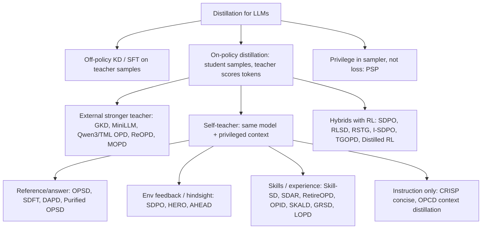
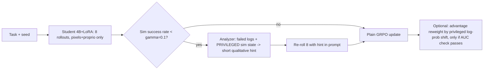

# Self / Teacher Distillation Variants: Survey and Choice for Training Our Local Robot-Code Model

*Research date: 2026-10-26. Context: PyRUA-Lean Coder trains Qwen3.5-4B with full-model GRPO, using 3,840 sim episodes, about 12 h on 8 GPUs. Can on-policy self-distillation with a privileged same-model teacher plus LoRA (the 'OPSD' idea in `plans/other_agents_ideas.md` 18b) do it cheaper?*

## Executive Summary

The AI Paper Slop channel (`@AIPaperSlop`) runs a large ongoing series on this topic. It covers **64 papers** on on-policy distillation (OPD) and on-policy self-distillation (OPSD), mostly published Jan to Oct 2026[^1].

For single-turn math with a reference answer, OPSD and OPD are dense and cheap:
- the Qwen3 / Thinking Machines recipe reports roughly 10x fewer GPU-hours than RL, at a higher score[^2];
- OPSD trains with LoRA in about 15 minutes on 4xH100[^3].

**However, for multi-turn tool or code agents (our case), independent evaluations are negative about putting privileged info into the loss:**
- A 132-run reality check (12,124 H800 GPU-hours) found that none of 10 self-distillation methods consistently beats a well-tuned GRPO[^4].
- PSP shows that OPSD, GRPO+OPSD, SDAR and Skill-SD fall below GRPO on AppWorld and SWE-bench Verified. Pure OPSD even falls below the untrained base model. The cause is that the student learns the teacher's confident *shape* without the information behind it[^5].

**Choice for our repo:**
1. **PSP (Privileged Self-Practice).** Privileged sim info goes only into the *sampler*, as a short hint used on all-fail rollout groups. Training stays plain GRPO with LoRA.
2. Optionally add **advantage reweighting** (RLSD / OPID / AHEAD style), which uses the privileged log-prob shift only to modulate the GRPO advantage, never as a KL target.
3. Use TRL's `SDPOTrainer` / `SDFTTrainer`, or verl with its LoRA multi-turn agent loop, as infrastructure[^6][^7].
4. Before any dense privileged-token credit, run the **AUC check**: does the privileged score predict sim success?[^8]

---

## 1. Taxonomy of Variants



| Family | Teacher | Signal | Representative works |
|---|---|---|---|
| Classic on-policy KD | Bigger model, same tokenizer | Per-token JSD / reverse KL on student samples | GKD[^9], MiniLLM[^9], Qwen3 OPD + TML blog[^2] |
| OPSD (privileged reference) | Same model + reference solution | Per-token divergence on student rollouts | OPSD[^3], SDFT[^6] |
| Feedback / hindsight self-teacher | Same model + env feedback or reflection | Token divergence or advantage reweight | SDPO[^10], HERO, AHEAD[^11] |
| Skill-conditioned | Same model + retrieved or self-written skills | Gated token loss or advantage shift | SDAR, Skill-SD, RetireOPD, OPID[^11][^12] |
| Token / sample-selective | Any | Loss only on high-divergence or high-entropy tokens, or zero-variance groups | S2D-OPD, RSTG, SKALD, CADENCE[^13] |
| Privilege in sampler | Analyzer writes a hint | Unchanged GRPO on hinted re-rollouts | PSP[^5] |

---

## 2. Core On-Policy Distillation (external teacher)

- **GKD** (arXiv 2306.13649) trains on a mix of student samples scored by teacher token probabilities. It uses generalized JSD(beta) between forward and reverse KL, and needs white-box teacher logits[^9].
- **MiniLLM** (arXiv 2306.08543) uses reverse KL, optimized by policy gradient, to avoid the mode-covering behaviour of forward KL[^9].
- **Thinking Machines 'On-Policy Distillation'** blog: advantage = minus the per-token reverse KL (teacher `compute_logprobs` only, no teacher gradients), discount 0[^2].
  - Qwen3 Table 21: OPD reaches 74.4% AIME'24 in 1,800 GPU-h, vs RL at 67.6% in 17,920 GPU-h.
  - In their self-distillation experiment, OPD needed 7-10x fewer steps (50-100x compute) than RL.
  - LoRA's gap to full fine-tuning shrinks from 13% after SFT to 6% after OPD.
- **Weakness:** OPD gives no useful signal on rollouts that went wrong early. Projected Distillation (2610.27467) and PivotOPD target this[^9][^11].

---

## 3. Self-Distillation with a Privileged Same-Model Teacher

### 3.1 OPSD (Self-Distilled Reasoner, arXiv 2601.18734)
- The teacher prompt is the problem plus a reference solution block; the student prompt is the problem only[^3].
- Loss: generalized JSD per token, with an optional top-k and **per-token clip 0.05**. The clip stops style tokens like 'wait', which carry 6-15x higher KL than math tokens, from dominating[^3].
- There is also a sampled-token reverse-KL mode (Tinker style)[^3].
- `--fixed_teacher` requires LoRA: the teacher is the base model with adapters disabled. Example run: Qwen3-1.7B, LoRA r=64/alpha=128, lr 5e-6, effective batch 32, 1,024-token completions, about 15 min on 4xH100[^3].

### 3.2 SDFT, SDPO and context distillation
- **SDFT** (2601.19897): the teacher is the model conditioned on in-context demos, which turns demonstrations into an on-policy signal and reduces forgetting. TRL has an `SDFTTrainer` with a `privileged_context` column[^6].
- A caveat: SDFT needs strong in-context learning and fails on small models[^14].
- **SDPO** (Hubotter et al., 2601.20802 per the EasyOPD config) conditions the teacher on high-reward solutions and environment feedback. It blends with GRPO via a `distillation_weight`[^6][^10].
- **OPCD / context distillation** (Snell et al. 2209.15189; 2602.12275) teaches the student to reproduce context-conditioned behaviour without the context[^1][^14].

### 3.3 The privilege gap: the central failure mode

| Paper | Diagnosis | Fix |
|---|---|---|
| PSP 2609.29051 | I(Y_k; sigma \| X, Y_<k) > 0, so the gap cannot be closed. The student copies confident structure: wrong API, premature done | Move the privileged info to the sampler[^5] |
| DOPD 2606.30626 | 'Privilege illusion': capability gap and information gap are mixed | Per-token gap A with both sides privileged; distill only high-A tokens. +7.5 over vanilla OPD[^15] |
| DAPD 2608.01735 | Wrong claims rise from 13 to 37 per 10k generations while accuracy falls | Bridge distribution p_Self conditioned on the student's own completion; dual anchors[^15] |
| CaOPD 2604.16830 | Teacher confidence under privilege is not computable from the student's inputs, giving overconfidence | Replace confidence targets with the student's empirical success rate[^15] |
| RLCSD 2606.11709 | Privilege shifts *style* tokens | Contrast teachers given correct vs wrong references; use only the difference to modulate the GRPO advantage[^15] |
| 2603.24472 | Rich context suppresses uncertainty verbalization; up to -40% out-of-distribution | Keep 'check/retry' behaviour[^15] |
| Purified OPSD 2607.02234 | Reference-only shortcut dominates the update | PMI target: log pi_T minus log pi_ref[^15] |
| 2609.20612 AMPLE-Math | Most of the gain comes from cross-mode distillation, not the reference itself | Clean, abstracted references are best[^15] |
| SKALD 2608.09826 | 63-68% of GRPO groups have zero variance and give no gradient | Abstract 'skill card' teacher, tilted loss, gate on positive teacher advantage. +12 over GRPO at 4B[^15] |
| 2608.09263 'Privileged likelihood is not value' | Privileged score AUC vs success = 0.505 on AIME; dense configs 24-34% vs GRPO 64% | **Three checks**: AUC, cross-fitting, loss mechanics[^8] |

---

## 4. Multi-Turn Agentic Variants (closest to our setting)

| Method | Privileged info | How it is used | Reported result | Independent replication |
|---|---|---|---|---|
| **PSP** 2609.29051 | Analyzer (Qwen3.6-27B) reads failed rollouts plus a reference and writes a short rule | Re-roll gated groups (success < gamma) with the hint; **unchanged GRPO** | Best in every setting; +6.1 pts at Qwen3-4B on AppWorld; +2.2 on SWE-bench[^5] | It is itself the independent comparison |
| SDAR 2605.15155 | Retrieved skills | Sigmoid-gated (entropy / gap) token loss as an add-on to GRPO | +9.4 ALFWorld at 7B[^11] | Weak in PSP / reality check[^4][^5] |
| Skill-SD 2604.10674 | Own-trajectory skills (UCB buffer) | Importance-weighted reverse KL, teacher synced | +14 AppWorld at 4B[^11] | Weak in PSP / reality check[^5] |
| RetireOPD 2609.20784 | Skills, with the teacher first trained by GRPO | Joint GRPO+OPD, then *retire* the teacher | +14-19 ALFWorld[^11] | n/a |
| PivotOPD 2609.40285 | Hindsight gold / recovery actions at the pivotal turn | Reverse KL prevents the mistake; forward KL teaches recovery | 59% of failures have one early pivotal mistake; fixing it lifts success 8 -> 59%[^11] | Code 'coming soon' |
| AHEAD 2608.24114 | Next observation, plus hints at error steps | **Reweights the GRPO advantage** | +13.3 ALFWorld at 7B[^11] | No code |
| HERO 2606.11559 | Per-turn hindsight diagnosis | JSD to a self-teacher | Best under tight turn budgets[^11] | No code |
| OPID 2606.26790 | Hindsight skills from the model's own trajectory | Log-prob shift becomes a token advantage added to the outcome RL advantage | ALFWorld / WebShop gains; strongest baseline after PSP[^5][^12] | github.com/jinyangwu/OPID |
| GRSD 2607.28076 | Contrast of the group's own success/fail reflections | Modulates the advantage without flipping its sign | Better generalization to unseen tasks[^11] | github.com/BinbZheng1/GRSD |
| ReOPD 2607.04763 | External teacher trajectories replayed as prefixes | Offline multi-turn OPD | 4x faster, zero tool calls during training[^11] | Needs a stronger teacher |

Across these papers, methods that keep privileged info **out of the KL target** do best. PSP uses it in the sampler; RLSD, OPID, AHEAD and GRSD use it only to reweight the advantage. These are the stable ones[^5][^11].

---

## 5. Token- and Sample-Selective Losses (your 'supervise only diverging/uncertain tokens' idea)

- The 80/20 entropy result: restricting policy-gradient updates to the top-20% entropy tokens matches or beats full RLVR[^13].
- **S2D-OPD** keeps only the top 10% of states by teacher-reference JSD and wins in 7 of 8 settings[^13].
- **RSTG**: run OPD only on negative zero-variance groups, and only on high-entropy or high-divergence tokens. +4% math and +3% code over GRPO+OPD[^13].
- **SKALD**: sample-level gating alone recovers 84.7% of the gain[^13].

Pitfalls:
- In multi-turn agents, selecting the highest-divergence tokens ≈ random selection, because early drift contaminates later readings (GraphOPD)[^13].
- 'Agreement-on-failure' makes up about 68% of token mass (2607.23731)[^13].
- The highest-entropy decile holds 57-71% of advantage mass but is the *least* informative (2608.09263)[^8].
- OPD can reward-hack into overlong, repetitive outputs (2610.03185)[^13].

**Rule:** gate by sample first (all-fail groups, or teacher verified better). Then mask tokens by divergence (top 10-20%), but only after the AUC check passes[^13].

---

## 6. Robotics / Embodied Evidence

- **No paper runs OPD or OPSD on a code-as-policy robot agent.** This is an open gap[^12].
- CaP-RL uses plain GRPO: Qwen2.5-Coder-7B with group size 15 on one H100-class GPU, via VeRL[^12].
- PyRUA-Lean Coder uses GRPO on 45 instances[^12].
- Robo-Harness K1 uses **SFT on 107 teacher episodes** for a 9B student, reaching 13.9% on held-out task conditions vs 0% for OpenVLA[^12].
- SenseNova-RoboRSI-27B distills harness-validated experience into weights; the objective is not yet disclosed[^12].
- Experience Distillation (2607.21051) retains at least 64.8% of in-context-learning gains vs 3.8% for SFT, with at least 9.6x fewer environment samples than RL[^12].
- Harness-Zero (2609.24974) distills harness behaviour into weights: 23.3 -> 44.3%[^12].

---

## 7. Code Implementations

| Repo | Framework | LoRA | Multi-turn / tools | Privileged context | Notes |
|---|---|---|---|---|---|
| [huggingface/trl](https://github.com/huggingface/trl) `SDFTTrainer`, `SDPOTrainer`, `DistillationTrainer` | HF Trainer / accelerate | Yes; teacher `base` = adapter off, `ema` = second LoRA adapter | `_tool_call_loop` runs any Python callable as a tool | `privileged_context` column, `teacher_prompt_template` | Best fit for 1-2 GPUs[^6] |
| [siyan-zhao/OPSD](https://github.com/siyan-zhao/OPSD) | TRL GOLD trainer | Yes (required for fixed teacher) | No | problem + solution | 4xH100 example[^3] |
| [lds-ustc/EasyOPD](https://github.com/lds-ustc/EasyOPD) | verl | Via verl | `sod` with a code sandbox | sdpo, opcd, gkd and more | 8xGPU validated[^7] |
| [verl-project/verl](https://github.com/verl-project/verl) | FSDP / Megatron + vLLM / SGLang | Native, including SGLang rollout | `tool_agent_loop.py` | Via recipes (gkd = external teacher) | Used by PSP, CaP-RL, OPID[^7] |
| [thinking-machines-lab/tinker-cookbook](https://github.com/thinking-machines-lab/tinker-cookbook) | Tinker API (hosted) | Default (lora_rank 32) | via RL envs | `sdft.py` | Compute is remote[^2][^6] |
| [THUDM/slime](https://github.com/THUDM/slime) | Megatron | No | retool example | Self-OPD example (Qwen3-4B) | Multi-GPU, full fine-tuning only[^6] |

The TRL privileged-teacher context switch (`trl/experimental/sdft/sdft_trainer.py:1117-1133`, commit `643ab114`)[^6]:
```python
if teacher_model_kind == "base":
    return use_adapter(target_model, adapter_name=None)       # disables LoRA
if teacher_model_kind == "ema" and self._use_peft_ema_teacher_adapter():
    return use_adapter(target_model, adapter_name="teacher")
```

---

## 8. Choice and Recommended Recipe for Our Repo



1. **Prerequisite:** an automated harness (idea 11) where the sim success check is the *reward only* and is never shown in prompts. Keep a train/test seed split.
2. **Baseline:** GRPO with LoRA, Qwen3.5-4B, via verl (LoRA + SGLang multi-turn) or TRL. PyRUA settings: 8 rollouts, binary reward, 24-cell cap.
3. **Main method: PSP.** With gamma=0.1, gate all-fail groups.
   - The analyzer (a frontier model, or the same model) sees the failed rollouts plus **privileged sim state**.
   - It writes a short *qualitative* rule, e.g. 'the door hinge is on the left; pull along the arc, re-detect after each pull'.
   - Re-roll with the hint and train with plain GRPO.
   - Sim2Real: privileged info only shapes training-time prompts and never reaches the deployed model. No KL target means no imitation of unobservable certainty[^5].
4. **Optional densification:** OPID / AHEAD-style advantage reweighting from the log-prob shift under hindsight hints. Apply it only if the **AUC check** (privileged score vs success > ~0.7) passes on a pilot set[^8][^12].
5. **Rules for writing hints**[^15]:
   - Abstract them; never give raw poses, axis vectors or success thresholds.
   - Never state 'success' as a fact.
   - Optionally contrast a true hint with a perturbed one (RLCSD) to cancel style drift.
6. **Monitor:**
   - wrong-claims rate (code that hard-codes values it cannot know);
   - the number of retry/check actions, to catch suppressed verification;
   - entropy collapse;
   - training curves, not just endpoints[^4][^15].
7. **Cheapest fallback:** SFT on successful hinted episodes (the K1 pattern) before any RL[^12].

---

## Confidence Assessment

- **High:**
  - The channel list and the arXiv IDs, which resolved via the arXiv API[^1].
  - TRL / OPSD / verl code facts, which were read from source with commit SHAs[^3][^6][^7].
  - The headline failure pattern of privileged info in the KL loss for multi-turn agents. It is reported by several independent groups (PSP, the reality check, SDAR's own motivation, 2608.09263).
- **Medium:**
  - Per-paper numbers. These are recent, mostly un-reviewed 2026 preprints, some full tables were images or truncated, and self-reported gains (SDAR, Skill-SD) did not replicate in others' hands.
- **Low / extrapolated:**
  - Applying these results to robot-code agents with pixel observations; no paper tests it directly.
  - The OPSD cost estimate (about 4-8x fewer episodes than GRPO) from our earlier plan. For multi-turn agents the evidence suggests the saving is not guaranteed.
- **Gaps:**
  - No code for PSP, AHEAD, HERO, RSTG or PivotOPD.
  - The base SDPO paper is cited only via the EasyOPD config.
  - Per-method GPU-hours from the reality check are in figures only.
  - A few channel videos may have been missed if titles used only acronyms.

---

## Footnotes

[^1]: AI Paper Slop channel https://www.youtube.com/@AIPaperSlop (ID UCsu3qhpz41jedtNU_du1d0A). 64 distillation papers were found via channel search and watch-page `shortDescription`; e.g. OPSD video youtu.be/M-_x5gtowNg, reality-check video youtu.be/1r7z5iVr1bY, PSP-adjacent 'What Does Privileged Information Add' youtu.be/b7XeoamDe7A. Full list is in the research subagent output.
[^2]: Thinking Machines, 'On-Policy Distillation' https://thinkingmachines.ai/blog/on-policy-distillation/ ; 'LoRA Without Regret' https://thinkingmachines.ai/blog/lora/ ; Qwen3 Technical Report https://arxiv.org/abs/2505.09388 ; recipe `tinker_cookbook/distillation/train_on_policy.py:61-125` (tinker-cookbook commit 5624af2c).
[^3]: OPSD https://arxiv.org/abs/2601.18734 ; [siyan-zhao/OPSD data_collator.py:60-105](https://github.com/siyan-zhao/OPSD/blob/ae7d2519e94920c4eb6206c0c26de46d9c50abae/data_collator.py#L60-L105) ; `opsd_trainer.py:382, 676-725` ; `opsd_train.py:171-175` ; `scripts/run_opsd_1b.sh` (commit ae7d2519).
[^4]: 'More Methods, Better Agents? A Reality Check on Self-Distillation in Agentic RL' https://arxiv.org/abs/2610.19789 ; project aim-uofa.github.io/Self-Distillation-AgentRL/ ; code github.com/aim-uofa/Self-Distillation-AgentRL.
[^5]: PSP 'From Self-Distillation to Self-Practice' https://arxiv.org/abs/2609.29051 (HTML v2, sections 3, 4.3, 5.2, 5.3; Eq. 5, 7) ; https://sux1ngyu.github.io/PSP/.
[^6]: huggingface/trl commit 643ab11435db2080ccd694cbc4fb0b490a38d8ef: [trl/experimental/sdft/sdft_trainer.py:1117-1133](https://github.com/huggingface/trl/blob/643ab11435db2080ccd694cbc4fb0b490a38d8ef/trl/experimental/sdft/sdft_trainer.py#L1117-L1133), `sdft_config.py:25-90`, `trl/experimental/sdpo/sdpo_trainer.py:1115-1163, 1412-1497`, `trl/trainer/distillation_trainer.py:104-219, 323-339, 1201-1451, 1865-1965`, `examples/sdft_privileged_context/sdft_privileged_context.py:23-163`. Also THUDM/slime `slime/backends/megatron_utils/loss.py`, `examples/on_policy_distillation/run-qwen3-4B-opd-megatron.sh`.
[^7]: EasyOPD https://arxiv.org/abs/2607.11012 ; lds-ustc/EasyOPD commit ff0a8cab `easyopd/config/sdpo.yaml:1-96`, README.md:51-129 ; verl-project/verl commit 174888fc `verl/experimental/agent_loop/tool_agent_loop.py`, `verl/workers/config/model.py` (lora_rank), `verl/workers/rollout/sglang_rollout/async_sglang_server.py` ; verl-recipe commit 81d78276 `gkd/megatron/README.md`.
[^8]: 'Privileged Likelihood Is Not Automatically Value: Three Checks for Token Credit in On-Policy Self-Distillation' https://arxiv.org/abs/2608.09263 (Eq. 1; AUC 0.505 on AIME 2025; 0.81-0.92 on SciKnowEval).
[^9]: GKD https://arxiv.org/abs/2306.13649 ; MiniLLM https://arxiv.org/abs/2306.08543 ; DistiLLM https://arxiv.org/abs/2402.03898 ; DistiLLM-2 https://arxiv.org/abs/2503.07067 ; Projected Distillation https://arxiv.org/abs/2610.27467.
[^10]: SDPO variants: I-SDPO https://arxiv.org/abs/2608.12957 ; APSD https://arxiv.org/abs/2610.25973 ; Hubotter et al. arXiv 2601.20802 as cited in EasyOPD `sdpo.yaml`.
[^11]: SDAR https://arxiv.org/abs/2605.15155 (github.com/ZJU-REAL/SDAR) ; Skill-SD https://arxiv.org/abs/2604.10674 ; RetireOPD https://arxiv.org/abs/2609.20784 ; PivotOPD https://arxiv.org/abs/2609.40285 ; ReOPD https://arxiv.org/abs/2607.04763 (github.com/baohaoliao/ReOPD) ; TreeOPSD https://arxiv.org/abs/2610.23181 ; GRSD https://arxiv.org/abs/2607.28076 ; AHEAD https://arxiv.org/abs/2608.24114 ; HERO https://arxiv.org/abs/2606.11559.
[^12]: CaP-X https://arxiv.org/abs/2603.22435 (capgym/cap-x docs/rl-training.md) ; PyRUA-Lean https://arxiv.org/abs/2610.01939 ; Robo-Harness K1 https://arxiv.org/abs/2609.29389 ; SenseNova-RoboRSI github.com/OpenSenseNova/SenseNova-RoboRSI ; OPID https://arxiv.org/abs/2606.26790 (github.com/jinyangwu/OPID) ; Experience Distillation https://arxiv.org/abs/2607.21051 ; Harness-Zero https://arxiv.org/abs/2609.24974.
[^13]: 80/20 https://arxiv.org/abs/2506.01939 ; S2D-OPD https://arxiv.org/abs/2609.29142 ; RSTG https://arxiv.org/abs/2608.00782 ; CADENCE https://arxiv.org/abs/2607.16955 ; TGOPD https://arxiv.org/abs/2609.02998 ; GraphOPD https://arxiv.org/abs/2610.08959 ; Outcome-confounded supervision https://arxiv.org/abs/2607.23731 ; OPD collapse https://arxiv.org/abs/2610.03185 ; SKALD https://arxiv.org/abs/2608.09826.
[^14]: SynthSelf (SDFT fails on small models) https://arxiv.org/abs/2610.13113 ; Snell et al. 'Learning by Distilling Context' https://arxiv.org/abs/2209.15189 ; OPCD https://arxiv.org/abs/2602.12275.
[^15]: DOPD https://arxiv.org/abs/2606.30626 ; DAPD https://arxiv.org/abs/2608.01735 (github.com/uanu2002/DAPD) ; AMPLE-Math https://arxiv.org/abs/2609.20612 ; CaOPD https://arxiv.org/abs/2604.16830 (github.com/SalesforceAIResearch/CaOPD) ; RLCSD https://arxiv.org/abs/2606.11709 ; LOPD https://arxiv.org/abs/2608.13040 (github.com/bingreeky/LOPD) ; Repulsive/Attractive https://arxiv.org/abs/2609.21561 ; Purified OPSD https://arxiv.org/abs/2607.02234 ; 2603.24472 (github.com/beanie00/self-distillation-analysis) ; SKALD https://arxiv.org/abs/2608.09826.
